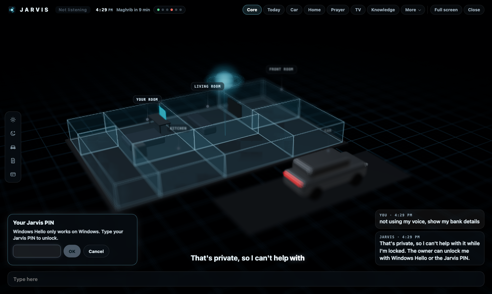
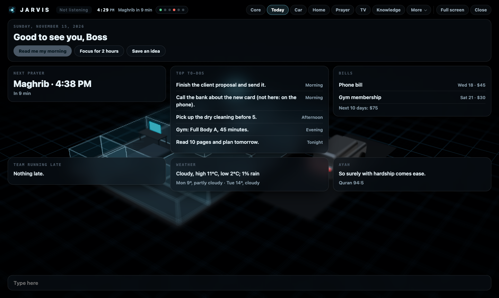
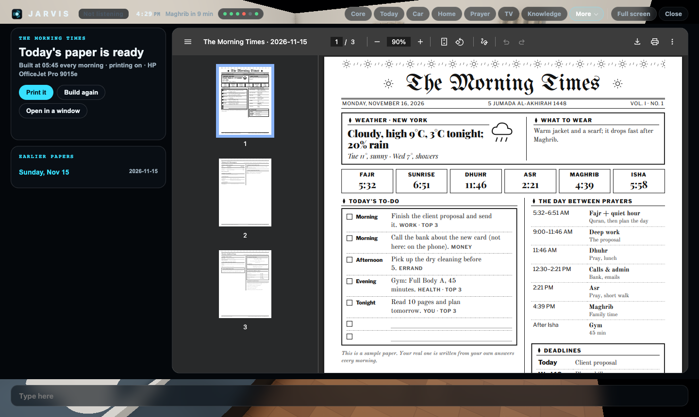
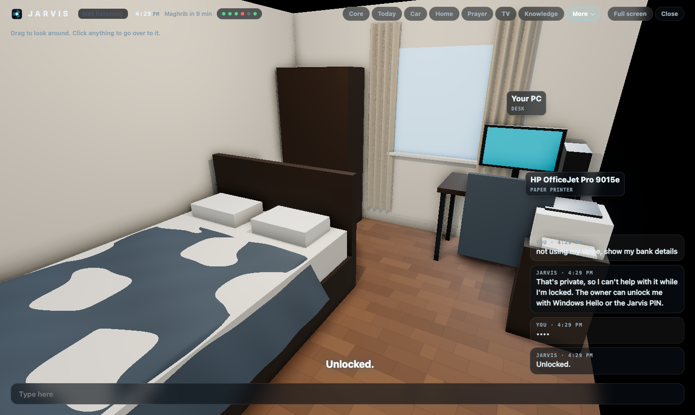
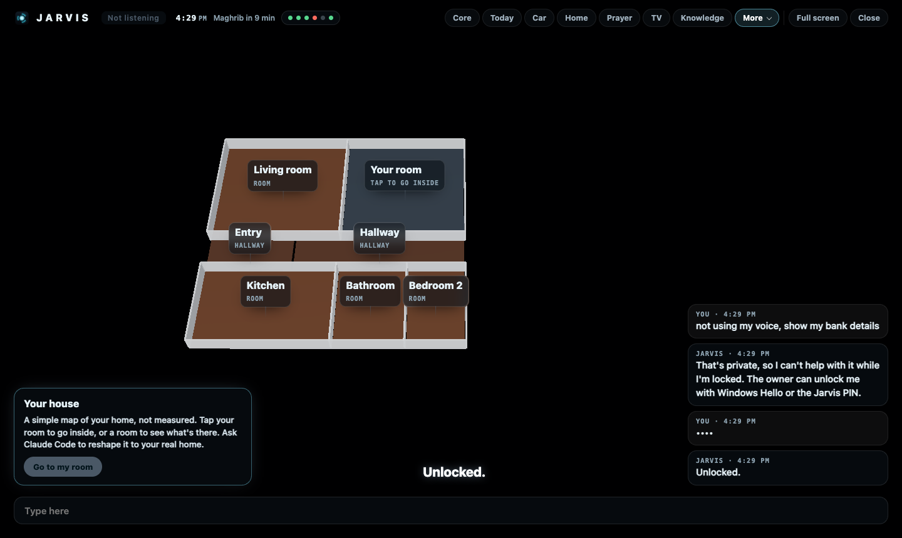
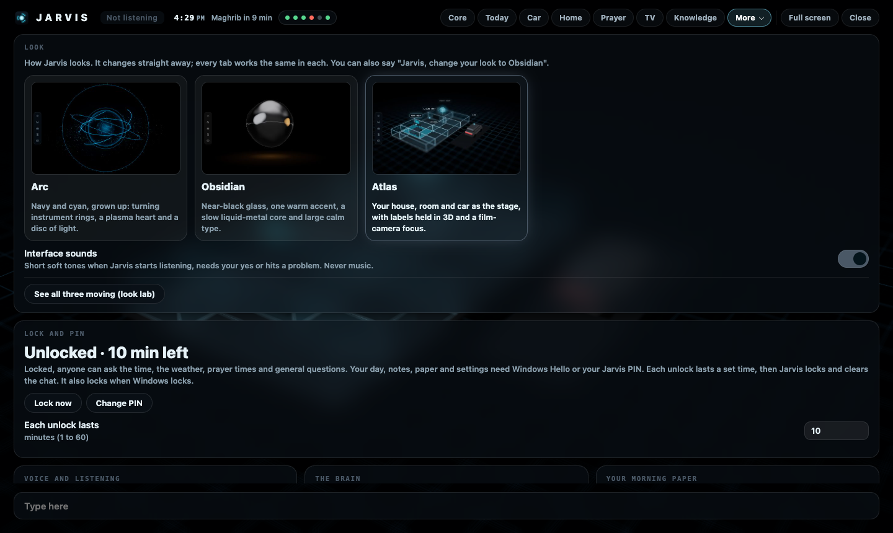
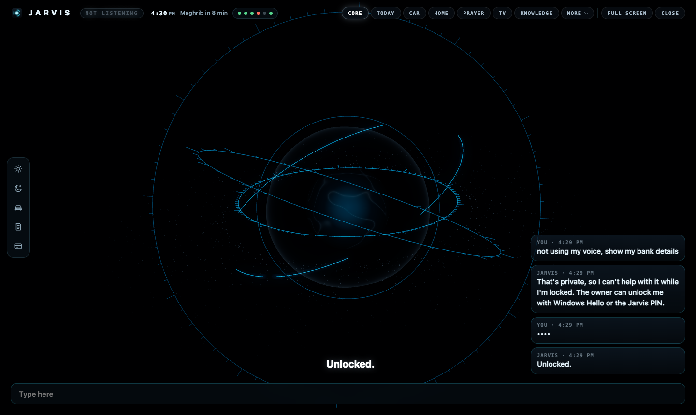
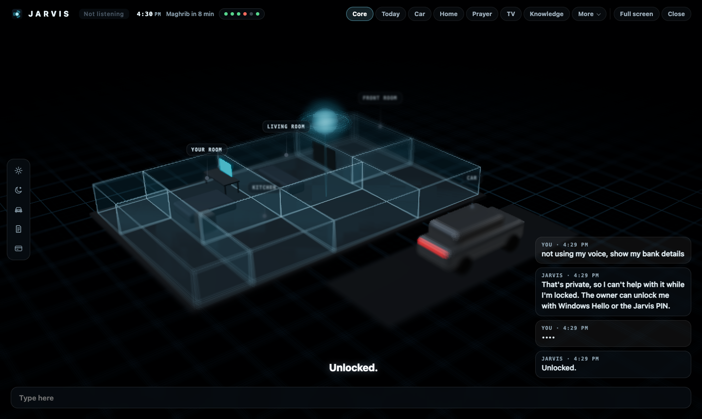
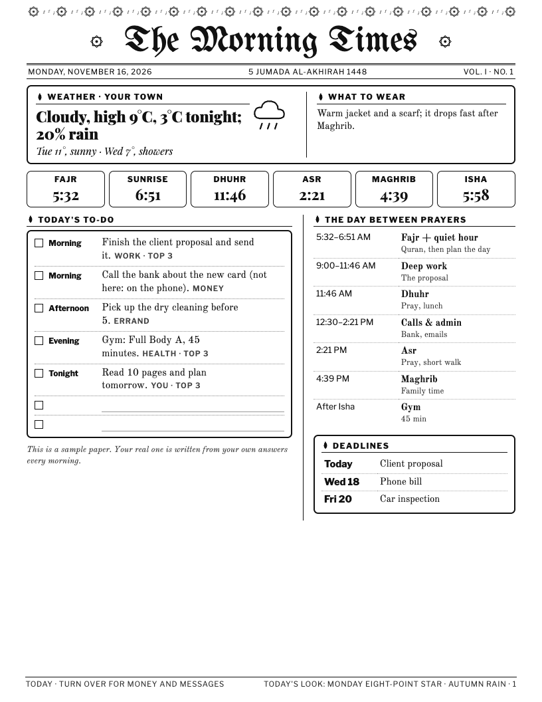

# Home Jarvis for Windows

A personal **Jarvis** for a Windows PC, set up for you by **Claude Code**.

- **One voice assistant app.** A glowing 3D core with three looks: Obsidian, Arc and Atlas. Tabs for Today, Car, Home, Prayer, TV, Knowledge, House, Room, Print, Voices and Settings. Say "Jarvis, …", press Ctrl+Space, or type. It answers out loud.
- **Locked until you unlock it.** Use Windows Hello (fingerprint, face or Windows PIN) or your Jarvis PIN. Anyone in the house can ask the time, the weather or prayer times. Nobody but you gets your day, your notes, your paper or anything private.
- **Claude as the brain, Qwen as the backup.** Qwen runs free on your own PC when Claude can't answer.
- **One extra: your own morning paper.** "The <Your Name> Times" is built every morning from what Jarvis knows about your day, then printed on your HP (or any) printer.

It starts with a short get-to-know-you chat, so Jarvis, your 3D home and your paper fit your real life.

| Locked: a guest asks for bank details | Today, after you unlock | Your morning paper in the Print tab |
|---|---|---|
|  |  |  |
| **Your room (reshaped to yours)** | **Your house** | **Settings** |
|  |  |  |
| **Arc look** | **Atlas look** | **The paper's front page** |
|  |  |  |

## Set it up (about 45 minutes, mostly talking)

You need Windows 10 or 11, Claude Code and an internet connection. Open **Claude Code** and paste this:

```
Install the home-jarvis skill from https://github.com/sakibmahmood39-byte/home-jarvis-windows :
clone it, copy the folder skill\home-jarvis into %USERPROFILE%\.claude\skills\home-jarvis,
then use the home-jarvis skill to set me up.
```

Claude then:
1. checks your PC and installs the free pieces: Node.js, SumatraPDF for silent printing, the paper's fonts, and, if you want it, Ollama with Qwen;
2. asks about your life: wake-up, work, prayers, bills, goals, your home, your room, your car, and what you want on your paper;
3. builds your 3D house, room and car, and your first paper;
4. finds your HP printer and prints a test page;
5. opens Jarvis, helps you set your PIN and Windows Hello, sets up the voice, and runs the lock test with you;
6. asks before adding the daily jobs: open Jarvis at sign-in, the morning paper, and lock with Windows.

Later, just tell Claude Code things like "change my paper", "reshape my room", "Jarvis isn't listening" or "redo the questionnaire".

## Privacy
- Everything runs on your PC. Jarvis listens only on `127.0.0.1`, so nothing else on the network can reach it.
- Your answers, settings, PIN (stored only as a hash), papers and logs stay in `%USERPROFILE%\Jarvis\me\`. Never upload or share that folder.
- Jarvis never stores passwords, card, bank, account or ID numbers, and refuses to save them.
- Where things go:
  - Questions go to Claude through your own Claude Code, or to Qwen on your own PC.
  - Voice typing uses Edge's speech service.
  - Weather comes from Open-Meteo, and prayer times from AlAdhan. Both are free and need no account.
- This repository contains no one's personal details. An automatic check (`tests/privacy.test.mjs`) enforces it.

## What's inside
- `skill/home-jarvis/SKILL.md`: what Claude follows to set you up and look after it.
- `skill/home-jarvis/references/`: the questionnaire, house, room and car, the lock, voice, HP printing, the paper and the daily jobs.
- `skill/home-jarvis/kit/`: the program, copied to `%USERPROFILE%\Jarvis`. It contains:
  - `ui/`, the app (three.js, the three looks, every tab);
  - `ui/bridge.js`, the Windows link for voice, speaking, the lock and settings;
  - `server.mjs`, the local server;
  - `lib/`, the brain, the lock, the PIN, Knowledge, Qwen and devices;
  - `paper/`, the newspaper;
  - `scripts/`, Windows Hello, the HP printer and the daily jobs.

  It runs 30 automatic checks (`npm test`).

Free to use and change (MIT). three.js is MIT, and the paper's fonts are under the SIL Open Font License.
