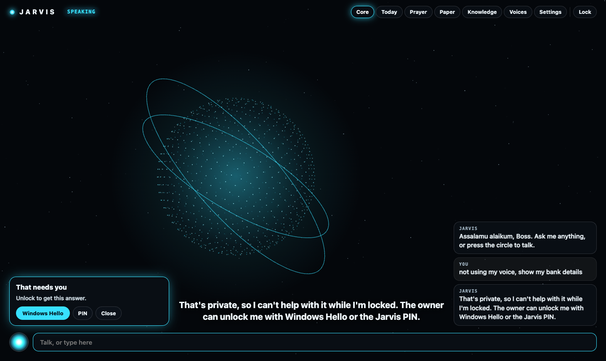
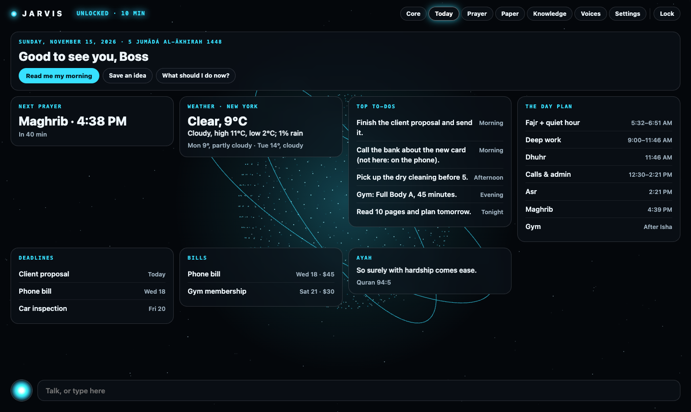

# Home Jarvis for Windows

A personal **Jarvis** for a Windows PC, set up for you by **Claude Code**.

- **One voice assistant app.** A glowing core, with tabs for Today, Prayer, Paper, Knowledge, Voices and Settings. Talk to it or type, and it answers out loud.
- **Locked until you unlock it.** Use Windows Hello (fingerprint, face or Windows PIN) or your Jarvis PIN. Anyone in the house can ask the time, the weather or prayer times. Nobody but you gets your day, your notes or anything private.
- **One extra: your own morning paper.** "The <Your Name> Times" is built every morning from what Jarvis knows about your day, then printed on your HP (or any) printer.

It starts with a short get-to-know-you chat, so Jarvis and the paper fit your real day.





## Set it up (about 45 minutes, mostly talking)

You need Windows 10 or 11, Claude Code and an internet connection. Open **Claude Code** and paste this:

```
Install the home-jarvis skill from https://github.com/sakibmahmood39-byte/home-jarvis-windows :
clone it, copy the folder skill\home-jarvis into %USERPROFILE%\.claude\skills\home-jarvis,
then use the home-jarvis skill to set me up.
```

Claude then:
1. checks your PC and installs the free bits (Node.js, SumatraPDF for silent printing, the paper's fonts);
2. asks you about your day: wake-up, work, prayers, bills, goals, and what you want on your paper;
3. builds your first paper and lets you change the front page;
4. finds your HP printer and prints a test;
5. opens Jarvis, helps you set your PIN and Windows Hello, sets up the voice and runs the lock test with you;
6. asks before adding the daily jobs (open Jarvis at sign-in, the morning paper, lock with Windows).

Later, just tell Claude Code things like "change my paper", "Jarvis isn't listening" or "redo the questionnaire".

## Privacy
- Everything runs on your PC. Jarvis listens only on `127.0.0.1`, so nothing else on the network can reach it.
- Your answers, settings, PIN (stored only as a hash), papers and logs stay in `%USERPROFILE%\Jarvis\me\`. Never upload or share that folder.
- Jarvis never stores passwords, card, bank, account or ID numbers, and refuses to save them.
- Questions go to Claude through your own Claude Code. Voice typing uses Edge's speech service. Weather comes from Open-Meteo and prayer times from AlAdhan. All are free and need no account.

## What's inside
- `skill/home-jarvis/SKILL.md`: what Claude follows to set you up and look after it.
- `skill/home-jarvis/references/`: the questionnaire, the lock, voice, HP printing, the paper and the daily jobs.
- `skill/home-jarvis/kit/`: the program, copied to `%USERPROFILE%\Jarvis`. Its 27 automatic checks cover the lock, the app and the paper (`npm test`).

Free to use and change (MIT). The paper's fonts are under the SIL Open Font License.
